# Schéma synthétique — architecture fonctionnelle finale

```mermaid
flowchart LR
    subgraph SRC["5 documents sources"]
        direction TB
        s1["F1 Formations &amp; Modules"]
        s2["F2 Bâtiments / espaces"]
        s3["F3 Volumes horaires"]
        s4["F4 Vagues 2026"]
        s5["F5 Organisation (doublon)"]
    end

    subgraph ING["Ingestion contrôlée"]
        direction TB
        imp["importer_referentiels_injs<br/>idempotent · transactionnel · --dry-run"]
        chk["verifier_coherence_referentiels<br/>22 constats numérotés"]
    end

    subgraph CAT["Catalogue — 26 référentiels / 7 catégories"]
        direction TB
        A["A Institutionnel<br/>Écoles · Mentions"]
        B["B Offre de formation<br/>Filières · Natures de cursus · Cycles<br/>Modules officiels (227) · Volumes (51)"]
        C["C Système LMD<br/>Niveaux · Parcours · Semestres · UE/ECUE"]
        D["D Pédagogiques<br/>Types d'enseignement · d'espace<br/>d'évaluation · de décision"]
        E["E RH pédagogiques<br/>Grades enseignants"]
        F["F Organisation<br/>Statuts de vague · Sites · Bâtiments<br/>Salles · Vagues"]
        G["G Administratif &amp; scolarité<br/>Paiements · Documents · Frais<br/>Notifications · Années"]
    end

    subgraph API["API unique /api/referentiels/"]
        direction TB
        a1["tableau-de-bord/"]
        a2["&lt;slug&gt;/ CRUD + archiver/reactiver"]
        a3["modules-officiels/ · volumes-horaires/ (lecture)"]
    end

    subgraph UI["Frontend"]
        direction TB
        u1["/referentiels — Tableau de bord"]
        u2["/referentiels/gestion/:slug — CRUD"]
        u3["Écrans métier hérités"]
    end

    subgraph CONSO["Modules consommateurs"]
        direction TB
        c1["Formations / Maquettes"]
        c2["Admissions / Inscriptions"]
        c3["EDT / Évaluations / Jurys"]
        c4["Diplômes / Statistiques"]
    end

    s1 --> imp
    s2 --> imp
    s3 --> imp
    s4 --> imp
    s5 -. "non importé" .-> imp
    imp --> CAT
    CAT --> chk
    CAT --> API
    API --> UI
    CAT --> CONSO
```



## Légende

| Élément | Signification |
|---|---|
| Trait plein | Flux effectif, vérifié par test |
| Trait pointillé | Relation documentée mais volontairement sans import (doublon F5) |
| `OFFICIEL` | Donnée attestée par la source |
| `MODELISE` | Donnée déclarée comme proposition/reconstitution par la source |
| `CADRAGE` | Valeur nécessaire au fonctionnement mais non attestée |
| `A_RENSEIGNER` | Aucune source : l'écran l'affiche comme un manque, jamais comme une valeur |

## Chaîne LMD effective

```
École ─┐
Mention ┴─▶ Filière (F01…F08) ─▶ Cycle (Licence/Master) ─▶ [Parcours ─▶ Niveau ─▶ Semestre ─▶ UE ─▶ ECUE]
                                              │
                                              ├─▶ Modules officiels (227, à ventiler)
                                              └─▶ Volumes horaires (51, modélisés)
```

Les crochets signalent la partie de la chaîne gérée par le module **Maquettes** (déjà en place), non dupliquée ici.
