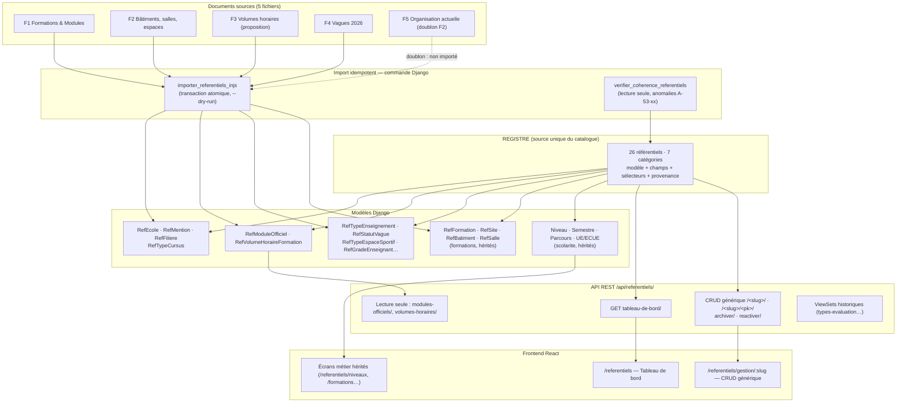

# Livrable 3 — Architecture fonctionnelle définitive

## 3.1 Principe directeur

Le module « Référentiels » n'est plus une collection d'écrans indépendants mais **un catalogue unique**, déclaré une seule fois dans `backend/referentiels/registre.py`. Tout le reste — API, navigation, tableau de bord, écrans de gestion, compteurs de complétude — est **dérivé** de ce registre.

Conséquences vérifiables :

1. **Une seule source de vérité** : un référentiel = un modèle Django = une entrée de registre. Un test (`test_aucun_doublon_de_modele`) échoue si deux entrées pointent le même modèle.
2. **Aucune liste codée en dur côté React** : le front lit `/api/referentiels/tableau-de-bord/` et affiche ce que le serveur déclare.
3. **Les référentiels historiques ne sont pas recréés** : ils sont déclarés `editable = False` avec un renvoi vers leur écran existant (`route_ui`) ou leur API réelle (`route_api`).
4. **La provenance est portée par la donnée** : `source_document` + `fiabilite` sur chaque enregistrement des référentiels issus de la refonte.

## 3.2 Cartographie des 7 catégories (26 référentiels)

| Catégorie | Référentiels | Éditables |
|---|---|---|
| **A — Institutionnel** | Écoles, Mentions | 2 / 2 |
| **B — Offre de formation** | Filières, Natures de cursus, Formations (cycles), Modules officiels, Volumes horaires | 2 / 5 |
| **C — Système LMD** | Niveaux, Parcours, Semestres, UE / ECUE | 0 / 4 |
| **D — Pédagogiques** | Types d'enseignement, Types d'espace sportif, Types d'évaluation, Types de décision | 4 / 4 |
| **E — RH pédagogiques** | Grades enseignants | 1 / 1 |
| **F — Organisation pédagogique** | Statuts de vague, Bâtiments, Salles et espaces, Sites, Vagues | 1 / 5 |
| **G — Administratif & scolarité** | Modes de paiement, Types de document, Types de frais, Types de notification, Années académiques | 4 / 5 |

*« Éditables » = pilotés par l'écran générique de la refonte (`/referentiels/gestion/:slug`). Les autres gardent leur écran métier d'origine.*

## 3.3 Chaîne LMD matérialisée

```
Année académique
   └── Filière (RefFiliere : école + mention + nature de cursus + code dossier F0x)
         └── Formation / cycle (RefFormation : filière + type de diplôme)
               └── Parcours (scolarite.Parcours)
                     └── Niveau (L1…M2)
                           └── Semestre (S1…S10)
                                 └── UE
                                       └── ECUE
```

La chaîne est **respectée dans les dépendances déclarées** : une filière ne peut exister sans école ; un cycle se rattache par `filiere_code` = `RefFiliere.code_dossier` (jamais par comparaison de libellés — voir anomalies corrigées en cours de mission) ; un module officiel porte son cycle, sa filière et son semestre documenté.

## 3.4 Schéma de l'architecture finale



## 3.5 Parcours utilisateur

1. **Entrée** : menu *Référentiels → Tableau de bord* (`/referentiels`).
2. **Cartographie** : 7 catégories, cartes cliquables avec compteurs (`valeurs`, `à renseigner`), état de complétude (Complet / Partiel / Vide) et badge de fiabilité.
3. **Gestion** : clic sur « Gérer » → `/referentiels/gestion/<slug>` : recherche, filtre actif/inactif/archivé, tableau, création, modification, activation/désactivation, archivage réversible avec confirmation.
4. **Consultation seule** : pour les tables importées (modules officiels, volumes horaires), le même écran s'ouvre en lecture seule, avec bandeau de provenance et sans action d'écriture.
5. **Écrans hérités** : conservés pour les référentiels dont la gestion est plus riche que du CRUD (niveaux, semestres, parcours, UE/ECUE, années, sites/bâtiments/salles, formations).

## 3.6 Décisions d'architecture

| # | Décision | Justification |
|---|---|---|
| D1 | Registre Python comme source du catalogue | Déclaration unique, testable, sans table de méta-données à maintenir |
| D2 | ViewSet générique paramétré par le slug | Un seul code de CRUD, journalisation et anti-doublon mutualisés |
| D3 | Routes `re_path` générées au démarrage depuis le registre | Ajouter un référentiel = ajouter une entrée ; aucune route oubliée |
| D4 | Les 8 référentiels du socle gardent leurs ViewSets dédiés | Compatibilité stricte des API existantes (`/types-evaluation/`, etc.) |
| D5 | Écran React générique unique | Zéro duplication de formulaire ; sélecteurs dépendants pilotés par le registre |
| D6 | Route dédiée `/referentiels/gestion/:slug` | Évite toute collision avec les écrans hérités déjà routés (`/referentiels/filieres`, `/referentiels/niveaux`…) |
| D7 | Archivage au lieu de suppression | Les dossiers historiques conservent leurs références |
