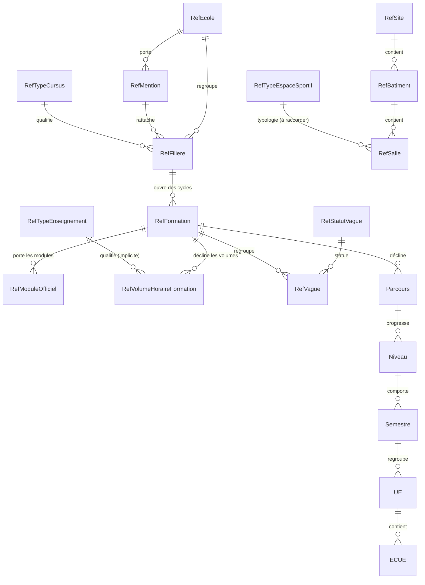

# Livrable 6 — Modèles et relations

## 6.1 Socle commun (`referentiels.RefSocle`)

Tous les référentiels éditables héritent de `RefSocle`, ce qui garantit un contrat homogène côté API :

| Champ | Type | Rôle |
|---|---|---|
| `code` | `CharField(50, unique)` | Identifiant métier, **immuable** après création |
| `libelle` | `CharField(150)` | Libellé officiel ; unicité normalisée (casse/accents) |
| `description` | `TextField` | Complément libre |
| `actif` / `date_activation` / `date_desactivation` | bool + datetimes | Cycle de vie |
| `archive` | bool | Archivage **réversible** (aucune suppression physique) |
| `annee_academique` | FK `scolarite.AnneeAcademique` (nullable) | Portée temporelle quand la valeur est millésimée |
| `source_document` | `CharField(255)` | Document attestant la valeur |
| `fiabilite` | choix `OFFICIEL / MODELISE / CADRAGE / A_RENSEIGNER` | Degré de confiance |
| `cree_le` / `modifie_le` | datetimes auto | Audit technique |

## 6.2 Modèles créés par la refonte

### `RefEcole`
`nom_complet` — établissement de rattachement. Relation : 1 école → N mentions, N filières.

### `RefMention`
`ecole` → `RefEcole` (**PROTECT**), `nom_complet`. Relation : 1 mention → N filières.

### `RefTypeCursus`
Nature de cursus. Aucune FK. Utilisée par `RefFiliere.type_cursus`.

### `RefFiliere`
| Champ | Relation |
|---|---|
| `ecole` | FK `RefEcole` (PROTECT) |
| `mention` | FK `RefMention` (PROTECT) |
| `type_cursus` | FK `RefTypeCursus` (PROTECT) |
| `code_dossier` | `CharField` — **F01…F08**, clé de réconciliation avec `formations.RefFormation.filiere_code` |
| `ordre` | ordre d'affichage officiel |

### `RefModuleOfficiel`
| Champ | Rôle |
|---|---|
| `formation` | FK `formations.RefFormation` (**CASCADE**, obligatoire) : le cycle qui porte le module |
| `filiere_code` | code court de la filière (EM, APA, ES, MS, AND, LOI, ECJP, GER) **tel que la source le nomme** |
| `semestre` | `S1…S10`, plage `S1-S3`, ou niveau `M1`/`M2` — **vide si la source ne le précise pas** |
| `libelle`, `ordre` | libellé officiel et position dans la liste source |
| `etat_ventilation` | `A_VENTILER` (défaut) / `VENTILE` / `HORS_MAQUETTE` |
| `source_document`, `fiabilite` | provenance (OFFICIEL) |

> Modèle **non éditable par l'API** : il est produit par l'import. Une correction passe par la source, puis par un nouvel import — la traçabilité reste intacte.

### `RefVolumeHoraireFormation`
`formation` (FK `RefFormation`), `intitule_module`, `heures_cm`, `heures_td`, `heures_tp`, `heures_stage`, `heures_total` (Decimal, nullables), `source_document`, `fiabilite` (`MODELISE`).

### `RefStatutVague`
`est_ouvert` (bool) : indique si le statut autorise des candidatures. Consommé par le module Admissions.

### `RefTypeEnseignement`
`abrege` (CM/TD/TP/STAGE), `est_stage` (bool) : distingue les heures de stage des heures pédagogiques.

### `RefTypeEspaceSportif`
Typologie des espaces (amphi, gymnase, salle informatique, salle de réunion, salle de TD, terrain extérieur).

### `ReferentielJournal`
Journal **append-only** : `action` (CREATION / MODIFICATION / ARCHIVAGE), `content_type` + `object_id`, `utilisateur`, `horodatage`, `detail` (diff JSON). Interdit en écriture dans l'admin Django.

## 6.3 Modifications des modèles existants

| Modèle | Ajout | Migration |
|---|---|---|
| `formations.RefFormation` | FK `filiere` → `referentiels.RefFiliere` (nullable, PROTECT) | `formations.0099` |
| `formations.RefVague` | `categorie` | `formations.0099` |
| `formations.RefSite` / `RefBatiment` / `RefSalle` | `source_document`, `fiabilite` | `formations.0100` |
| 8 référentiels du socle (`RefTypeEvaluation`…) | `fiabilite` | `referentiels.0002` |

## 6.4 Diagramme des relations

## 6.5 Règles de suppression (inchangées)

| Relation | `on_delete` | Effet |
|---|---|---|
| `RefMention.ecole`, `RefFiliere.ecole/mention/type_cursus`, `RefFormation.filiere` | `PROTECT` | Impossible de supprimer une école encore référencée : l'erreur est explicite, pas silencieuse |
| `RefModuleOfficiel.formation` | `CASCADE` | Un module officiel n'existe que rattaché à un cycle |
| Tous les référentiels du socle | — | Pas de `DELETE` exposé : **archivage** uniquement |
