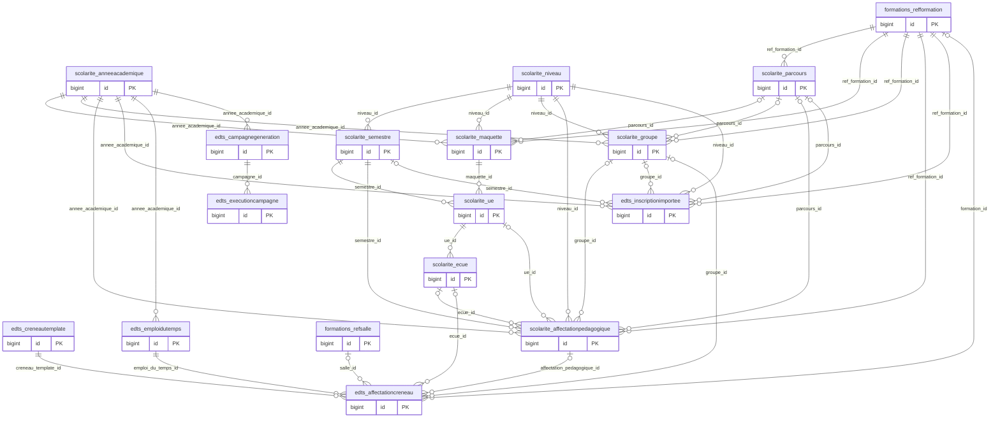
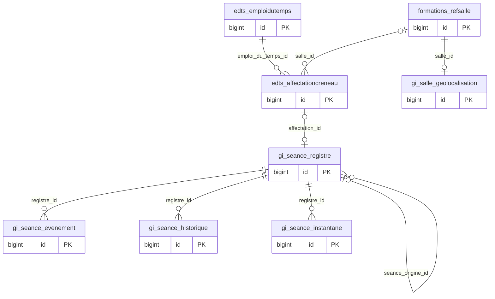

# GET INJS APP — schéma de données du code déployé

**Version de référence :** commit `70d08dad1821caceb61b22fe22cf70e13155bf18` (version de code mise en service sur le site public).
**Périmètre :** 28 modèles utiles à GET INJS APP (14 `edts`, 9 `scolarite`, 4 `formations`, 1 `authentication`), **357 colonnes** et **83 relations FK/O2O** dans ce sous-ensemble. Les 12 autres tables référencées sont listées plus bas. Les migrations déployées pour ces apps sont `edts.0012` et `scolarite.0020` ; la migration locale `scolarite.0021` n’est **pas** dans cette version.

> **Méthode et limite :** schéma extrait de l’introspection des modèles Django au commit exact, hors connexion à la production. Ce n’est pas un `pg_dump --schema-only` ni une attestation que chaque index/contrainte SQL physique a la même forme sur PostgreSQL. Le JSON détaille les colonnes, nullabilités, clés, index et contraintes déclarés ; le CSV permet de trier chaque colonne. Aucune ligne de données personnelle ou secret n’est inclus.

## Circuit des données

`Année académique` → `Formation` / `Parcours` / `Niveau` / `Semestre` → `Groupe` → `InscriptionImportee` et `Maquette ACTIVE` → `UE` → `ECUE` → `AffectationPedagogique` (si disponible) → `CampagneGeneration` / `ExecutionCampagne` → `EmploiDuTemps` → `AffectationCreneau` → `SeanceRegistre` / historique / événements.

**Précisions :** `edts_emploidutemps.population_type` + `population_id` forment une cible polymorphe, **pas une FK**. `edts_affectationcreneau.enseignant_id` est un entier, **pas une FK** ; `formateur_id` est une FK distincte. Les volumes CM/TD/TP résident dans `scolarite_ecue`; le besoin horaire est calculé par le moteur et **n’est pas une table persistée autonome**. Il n’existe pas de table `Promotion` : la cohorte est représentée par `scolarite_groupe`.

## Diagramme entité–relation principal (Mermaid)

## Registre des séances et interopérabilité (Mermaid)

## Inventaire des tables du périmètre

| Application | Table PostgreSQL prévue | Colonnes | Relations sortantes | Exemple de colonnes métier |
|---|---|---:|---:|---|
| `authentication` | `authentication_user` | 18 | 1 | `password`, `last_login`, `is_superuser`, `username` |
| `edts` | `edts_affectationcreneau` | 21 | 9 | `emploi_du_temps_id`, `creneau_template_id`, `semaine_debut`, `semaine_fin` |
| `edts` | `edts_campagnegeneration` | 15 | 2 | `annee_academique_id`, `libelle`, `semaines`, `perimetre` |
| `edts` | `edts_conflitcreneau` | 9 | 2 | `emploi_du_temps_id`, `type_conflit`, `description`, `lignes_creneaux` |
| `edts` | `edts_creneautemplate` | 5 | 0 | `jour`, `heure_debut`, `heure_fin`, `duree_prevue_minutes` |
| `edts` | `edts_disponibilitehoraire` | 11 | 3 | `annee_academique_id`, `enseignant_id`, `salle_id`, `jour` |
| `edts` | `edts_emploidutemps` | 20 | 4 | `annee_academique_id`, `population_type`, `population_id`, `population_denominateur` |
| `edts` | `edts_executioncampagne` | 12 | 2 | `campagne_id`, `numero`, `statut`, `lancee_par_id` |
| `edts` | `edts_inscriptionimportee` | 22 | 7 | `annee_academique_id`, `matricule`, `nom`, `prenoms` |
| `edts` | `edts_politiquecontraintessouples` | 15 | 1 | `actives`, `max_heures_consecutives`, `max_heures_par_jour`, `tolerance_minutes` |
| `formations` | `formations_formateur` | 16 | 2 | `numerobadge`, `nom`, `prenom`, `email` |
| `formations` | `formations_refformation` | 17 | 1 | `intitule`, `actif`, `archive`, `perimetre` |
| `formations` | `formations_refsalle` | 14 | 3 | `site_id`, `batiment_id`, `code`, `nom` |
| `formations` | `formations_refvague` | 16 | 5 | `code`, `libelle`, `ordre`, `actif` |
| `edts` | `gi_salle_geolocalisation` | 12 | 2 | `salle_id`, `latitude`, `longitude`, `rayon_tolerance_m` |
| `edts` | `gi_seance_evenement` | 6 | 1 | `type`, `registre_id`, `charge_utile`, `consomme` |
| `edts` | `gi_seance_historique` | 9 | 2 | `registre_id`, `action`, `statut_avant`, `statut_apres` |
| `edts` | `gi_seance_instantane` | 8 | 2 | `registre_id`, `date_seance`, `base_calculee`, `effectif` |
| `edts` | `gi_seance_registre` | 14 | 5 | `uuid`, `affectation_id`, `cle_metier`, `statut` |
| `scolarite` | `scolarite_affectationpedagogique` | 18 | 9 | `annee_academique_id`, `ref_formation_id`, `parcours_id`, `niveau_id` |
| `scolarite` | `scolarite_anneeacademique` | 12 | 0 | `libelle`, `date_debut`, `date_fin`, `courante` |
| `scolarite` | `scolarite_ecue` | 13 | 2 | `ue_id`, `code`, `intitule`, `credits` |
| `scolarite` | `scolarite_groupe` | 11 | 6 | `annee_academique_id`, `ref_formation_id`, `parcours_id`, `niveau_id` |
| `scolarite` | `scolarite_maquette` | 15 | 6 | `annee_academique_id`, `ref_formation_id`, `parcours_id`, `niveau_id` |
| `scolarite` | `scolarite_niveau` | 7 | 0 | `code`, `libelle`, `cycle`, `ordre` |
| `scolarite` | `scolarite_parcours` | 6 | 2 | `ref_formation_id`, `type_formation_id`, `code`, `intitule` |
| `scolarite` | `scolarite_semestre` | 5 | 1 | `niveau_id`, `numero`, `libelle`, `actif` |
| `scolarite` | `scolarite_ue` | 10 | 3 | `maquette_id`, `semestre_id`, `code`, `intitule` |

## Relations et portée

- **Enseignement :** `scolarite_anneeacademique` → `scolarite_groupe` et `scolarite_maquette`; `scolarite_maquette` → `scolarite_ue` → `scolarite_ecue` ; une affectation pédagogique est liée aux groupes/ECUE quand elle existe.
- **Génération :** `edts_campagnegeneration` → `edts_executioncampagne` ; `edts_emploidutemps` → `edts_affectationcreneau` → créneau, salle, groupe, ECUE ou affectation pédagogique. Les paramètres, semaines, bilans et anomalies sont des champs JSON de campagne/exécution : ce ne sont pas des relations SQL.
- **Traçabilité :** les tables `gi_seance_*` conservent l’identité, l’historique, les événements et les instantanés de séances ; `gi_salle_geolocalisation` prolonge la salle du référentiel.
- **Hors périmètre détaillé mais référencées par FK :** `formations_refbatiment`, `formations_refcategorie`, `formations_refgrade`, `formations_refmodule`, `formations_refsite`, `formations_secretariat`, `referentiels_reffiliere`, `referentiels_refgradeenseignant`, `referentiels_refstatutvague`, `referentiels_reftypeespacesportif`, `scolarite_famillemodule`, `scolarite_typeformation`.
- **Jointures M2M automatiques :** les relations groupes/permissions du modèle utilisateur et les champs M2M des modèles référencés peuvent créer d’autres tables physiques ; les tables `edts_*` du périmètre sont toutes détaillées dans le JSON.

## Fichiers téléchargeables

- `GET-INJS-SCHEMA-70d08da.pdf` : synthèse imprimable et relations principales.
- `GET-INJS-SCHEMA-70d08da-colonnes.csv` : inventaire complet des 357 colonnes (UTF-8 BOM, séparateur `;`).
- `GET-INJS-SCHEMA-70d08da.json` : types Django, nullabilité, FK, index/contraintes déclarés et M2M.
- `GET-INJS-SCHEMA-70d08da-principal.mmd`, `-interop.mmd` : diagrammes Mermaid ouvrables dans GitHub.
- `GET-INJS-SCHEMA-70d08da.zip` : l’ensemble et son manifeste SHA-256.

**Note calendrier :** l’année `2026-2027` a reçu en production des dates **provisoires non officielles** `01/10/2026`–`30/09/2027`. Ce sont des **valeurs de données**, pas des colonnes supplémentaires ni une norme de schéma.
